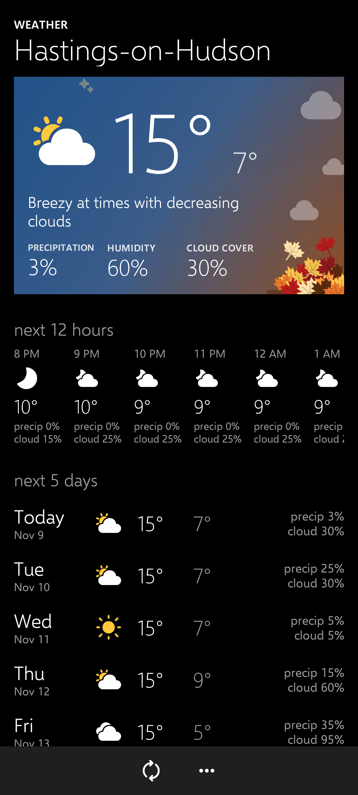
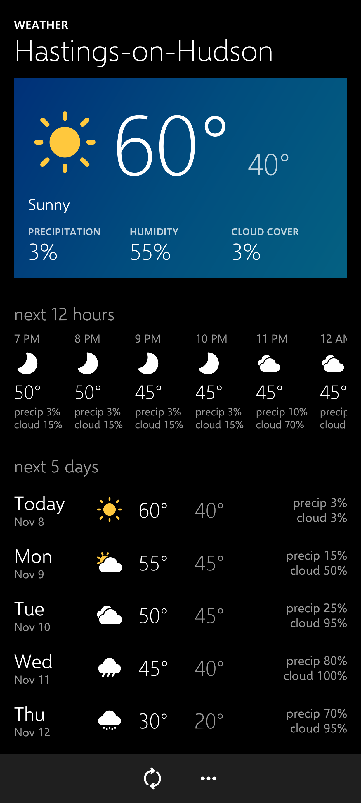
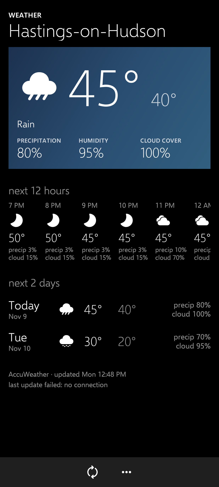
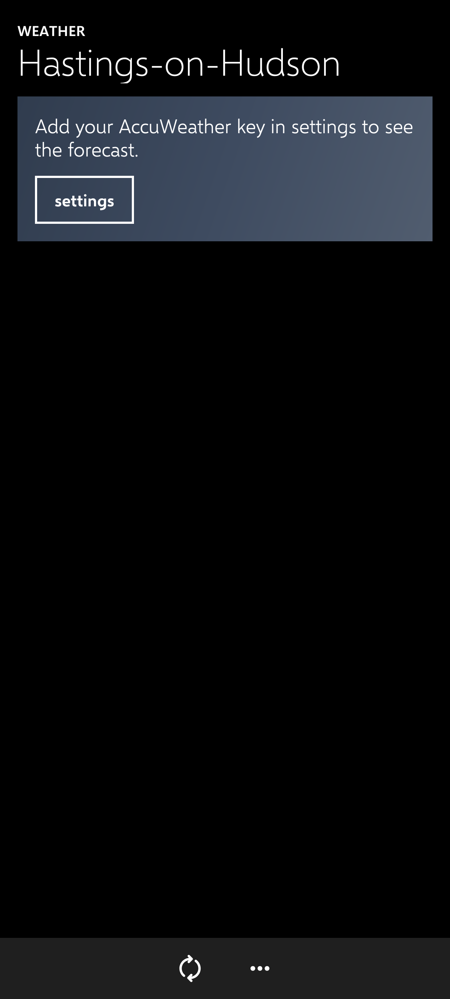
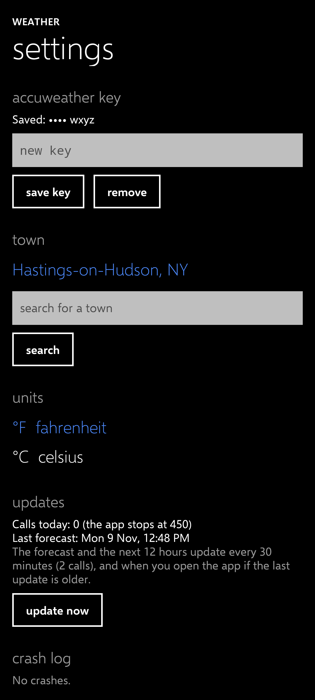
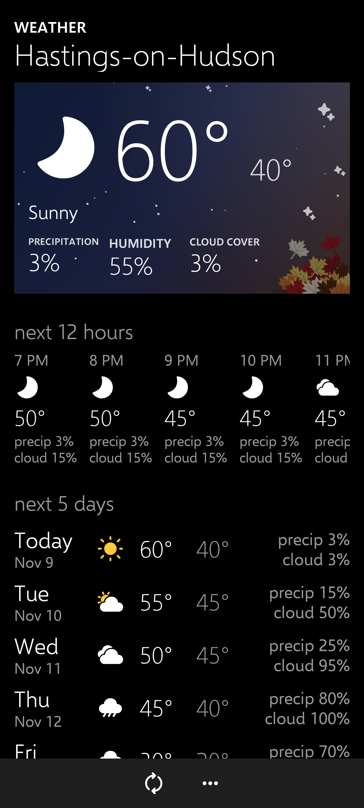
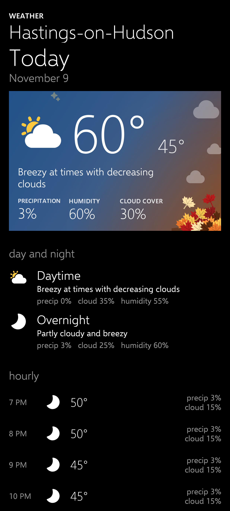
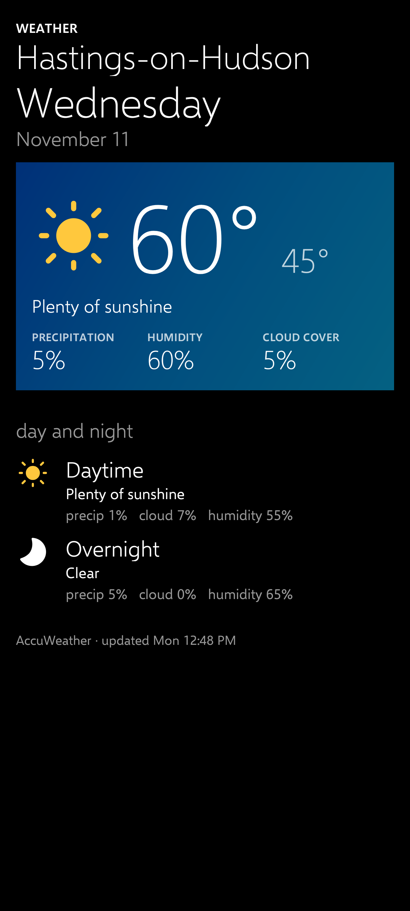
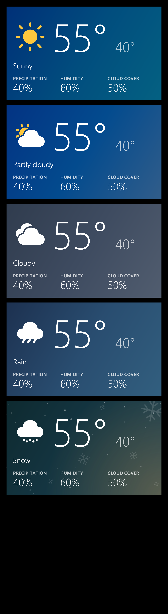

# PH-1: Weather app, AccuWeather, tile provider (8 Nov 2026)

Everything in docs/REQUIREMENTS.md v1.0: the launcher's handoff (WX-1 to WX-5) and Chris's screens (WX-6).

## What CI proves

- The release APK builds, shrunk and signed with the app's key (WX-4.5); the stand-in builds (WX-4.6).
- 35 unit and screenshot tests: classification of a sunny, partly cloudy, cloudy, rainy and snowy day, fog that clears and missing values (WX-3.6), the launcher's own classification cases unchanged (WX-3.2), town labels (WX-3.4), the rounding rule (WX-6.2), allowed and refused requests and the key only in the header (WX-2.2, 2.3), the default town looked up once (WX-2.7), call counting and the daily stop, failures keeping the last forecast (WX-2.8), slots (WX-2.5), the provider's callers, columns and read-only (WX-4), text contrast on the top block.
- Permission check (no location), network check (only dataservice.accuweather.com trusted) and a host check on the code and manifest, each also shown to reject a bad example (WX-2.3, WX-2.4).
- CI never calls AccuWeather (WX-2.9).

## Screens (from the screenshot tests; the forecast is test data)

| Real reply (9 Nov), °C, night hours | Forecast, °F | Rainy day, failed update | No key | Settings |
|---|---|---|---|---|
|  |  |  |  |  |

## What only the phone can show

1. Install the release APK. Open **Weather**: it asks for the key.
2. Tap **…** → paste the AccuWeather key → **save key**. Settings shows "Saved: •••• " and the key's last 4 characters.
3. Go back. Within a minute the forecast for Hastings-on-Hudson, NY appears (pull-free: it fills in by itself). Check the 12 hours and 5 days look right against AccuWeather's own app or site.
4. Every number should end in 0 or 5, or be 0 or odd between −9 and 9. Evening hours show a moon when clear.
5. Settings → **calls today** should read about 3 (town lookup, 5 days, 12 hours).
6. Search for another town, pick it: the forecast changes. Switch back with the recent towns list.
7. Switch °F/°C: the page changes.
8. Turn on airplane mode and tap refresh: the forecast stays, and settings shows "no connection".
9. Next morning, check the forecast updated by itself (settings → last forecast after 6 AM).

## Round 2: Chris's feedback (9 Nov)

| Chris asked | Done | Req |
|---|---|---|
| Current temperature cut off | High and low are one line that shrinks to fit; checked at 412 dp with text 30% larger than standard | WX-6.6 |
| Capitalise towns, days, months | "Hastings-on-Hudson", "Today", "Mon", "Nov 10", "November 10" | WX-6.6 |
| Remove ", …" by the town | The town's name only, shrinking to fit | WX-6.6 |
| Cloud cover everywhere, clearly labelled | "precip" and "cloud" on each hour, day and half day; PRECIPITATION, HUMIDITY, CLOUD COVER on the top block | WX-6.8 |
| Tap a day for its hours | Tapping a day opens it. Your plan ("starter") has only the next 12 hours: AccuWeather refused 24-, 72- and 120-hour forecasts. So each day shows its daytime and overnight halves, plus whichever of the next 12 hours fall on it | WX-6.7, Q5 |
| Update at least every 30 minutes | Every 30 minutes, 5 days + 12 hours together: 96 calls a day | WX-2.5 |
| Backgrounds for each condition | Below (the same gradients as the tile) | WX-6.1 |

CI: 44 unit and screenshot tests, permission, network and host checks.

| Larger text, 412 dp | Today, tapped | A later day, tapped | Each condition's background |
|---|---|---|---|
|  |  |  |  |

## Round 3: refresh feedback and festive snow (9 Nov)

Chris accepted round 2 except for these:

- Refresh turns the icon until the update comes back (WX-6.9).
- Pull the page down from the top and let go to refresh (WX-6.10).
- The snow block is slightly festive: evergreen to midnight, a faint warm glow, light snowfall and a few faint Fluent snowflakes (WX-6.11). Snow is the last block below.

CI: 50 unit and screenshot tests (refresh, pull, and the festive snow's text contrast among them).

